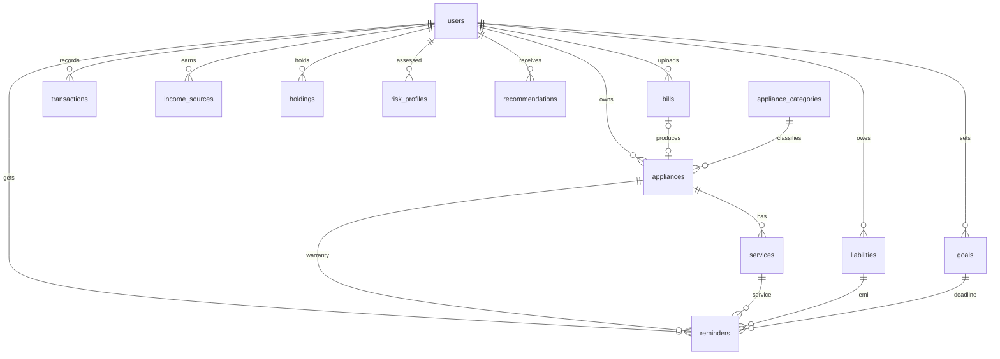

# Vault — Revision 2: Extended Scope

Revised Experiments 1–5 and build specification

Software Engineering Lab | Team: Vartika Sharma (J240211042), Tejas Kaushik (J240211034), Isha Shrivastav (J240211046), Sudarshan Gupta (J240211059)

This document replaces Experiments 1–5 of Revision 1. Parts 1–5 are the revised lab experiments. Part 6 gives exact calculation and rule specifications. **Part 7, the last section, contains the instructions for the AI coding assistant (Antigravity).** Read Part 0 first.

## Part 0 — What changed in Revision 2

Vault grows from a bill, warranty and budgeting app into a connected personal finance and asset-protection platform. It answers three questions: What do I have? What do I owe? What should I do next?

| Area | Revision 1 | Revision 2 |
| --- | --- | --- |
| Product | Bills, warranties, services, expenses, savings goals | Adds liabilities, financial holdings, net worth, emergency coverage, investment capacity, risk profile and an explainable advisor |
| Stack | React, Node/Express or FastAPI, MongoDB | Fixed: React (Vite), Python FastAPI, PostgreSQL |
| Advice policy | No investment advice | Decision support only: category-level guidance on user-entered data, with disclaimer. No product names, no trades |
| Data trust | Extraction corrected by user | Every material value carries source, last-updated date and confidence |
| Role of AI | Extraction | Extraction and explanation only. All numbers come from deterministic code |
| Functional requirements | 14 | 31 (FR-1 to FR-31) |
| Database tables | 8 | 13 |

Unchanged from Revision 1: the Experiment 2 elicitation results, the bill-upload activity and sequence diagrams, and ER relationships 1–9. Everything else below is either modified or new, and each item is marked.

## Part 1 — Experiment 1 (Revised): Problem Selection, Feasibility and Charter

### 1.1 Problem selection

People lose money in two connected ways. **Possession leakage:** warranties expire unclaimed, free services are missed, bills are lost. **Decision leakage:** spending is not understood, loans are ignored when deciding how much to invest, and goals are underfunded. The shared root cause is fragmented context: a receipt is treated as a document, an expense as a transaction, an appliance as a possession and a loan as a separate app. Vault connects them so one event informs several parts of the user's financial picture. For example, one refrigerator bill creates an asset, a purchase expense, a stored invoice, a warranty record and maintenance reminders.

### 1.2 Feasibility study (revised)

| Type | Answer | Result |
| --- | --- | --- |
| Technical | Python FastAPI handles OCR (pdfplumber, pytesseract), the calculations and the LLM adapter. React handles the UI and PostgreSQL the data. Calculations are plain arithmetic, so no model training is needed. | Feasible |
| Economic | Free tiers only. LLM and OCR calls have a mock mode, so development costs nothing. | Feasible |
| Operational | Users already use money apps. Manual entry avoids bank integrations and builds trust. First value (upload a bill) takes under 2 minutes. Risk: data-entry fatigue. | Feasible |
| Schedule | 31 requirements in a 14-day window is feasible only with the cut line in 7.9 and AI-assisted coding. A working end-to-end flow must exist by Day 6. | Conditionally feasible |
| Legal (new) | Personalised investment advice in India may fall under SEBI's Investment Advisers framework. Vault is therefore positioned as educational decision support on user-entered data, at category level only, with a disclaimer. | Feasible within this boundary |

**Conclusion:** feasible if the MVP boundary in 1.3 is respected.

### 1.3 Project charter

1. **Title:** Vault — Connected Personal Finance and Asset-Protection Platform
2. **Background:** Households and young earners lose money through forgotten entitlements and uninformed financial decisions. A bill is a purchase, an asset, a warranty and a maintenance obligation at once, and Vault treats these as connected records.
3. **Problem statement:** No single tool connects what a person owns (assets, warranties), owes (loans, EMIs, bills), saves (goals, holdings) and should do next. Existing apps are either only budgeting, only investing or only warranty tracking.
4. **Objectives:**
   1. Upload a bill and get product, brand, seller, price, date and warranty with confidence values.
   2. Auto-generate a service schedule and reminders for warranties, services and EMIs.
   3. Record income sources, expenses, liabilities and holdings manually.
   4. Compute net cash flow, savings rate, debt-to-income, net worth and emergency-fund coverage.
   5. Estimate sustainable investment capacity with a visible breakdown.
   6. Produce explainable, category-level recommendations (action, reason, assumptions, risks, alternatives, review trigger).
   7. Show goal progress and required contributions under three scenarios.
   8. Pilot with 3–5 real users and report honestly on accuracy and usefulness.
5. **Stakeholders:** students and young professionals (main users); families; faculty guide (evaluator); the 4-member team. Technician and financial partners are future stakeholders.
6. **Target users:** first-time earners with first appliances and first loans; secondary: families.
7. **Scope — in (MVP):** auth and consent; bill upload with extraction and correction; assets, warranties, services and reminders; income sources, transactions, liabilities, holdings; goals with projections; financial engine (cash flow, net worth, coverage, capacity); risk questionnaire; rule-based advisor with LLM explanation; dashboard and timeline; data export and delete. **Scope — out (future):** bank aggregation, SMS/email parsing, WhatsApp bot, trade or payment execution, named product recommendations, marketplace, claim auto-drafting, portfolio optimisation, family permissions, live market data.
8. **Technology:** React (Vite) + Tailwind; Python 3.11 FastAPI; PostgreSQL via SQLAlchemy and Alembic; pdfplumber and pytesseract for OCR; Claude or GPT API for extraction support and explanations (mock mode available); JWT auth; APScheduler for daily jobs; pytest; GitHub Actions.
9. **Team responsibilities (proposed):** Vartika Sharma — document intelligence (OCR, extraction, confidence, review flow). Isha Shrivastav — financial engine, advisor rules, service scheduler. Tejas Kaushik — frontend (onboarding, dashboard, assets, finances, goals, advisor screens). Sudarshan Gupta — database, APIs, auth, notifications, testing, CI/CD. Everyone helps with documentation and testing.
10. **Deliverables:** revised experiments (this document); working web app (MVP); seeded demo data; service-interval knowledge base; test plan, cases and report; CI pipeline; user feedback report; final documentation and demo.
11. **Timeline (14 days):** the whole project, including tests, CI, test report, retrospective and demo, fits in 14 days; the day-by-day plan and the cut line are in 7.9. The repository and CI skeleton are created on Day 1 so the history is real.
12. **Constraints:** zero budget; 4 students; 14 days in total; no regulated investment advice; no trade execution; extraction accuracy not guaranteed; all projections are illustrative.
13. **Assumptions:** users enter financial data manually and are willing to correct extracted data; free tiers remain available; 3–5 households agree to pilot.
14. **Risks:**

| Risk | Prob. | Impact | Mitigation |
| --- | --- | --- | --- |
| Bill extraction fails or is wrong | High | High | Per-field confidence; manual form; keep source file; PDF and clear photos first |
| Service intervals not standard | Medium | Medium | Own dataset for 6 categories; label as general guidance |
| Output mistaken for regulated advice (new) | Medium | High | Decision support wording; disclaimer; category-level only; no trades; documented in NFR-7 |
| Wrong or misleading financial numbers (new) | Medium | High | Deterministic engines; exact-value unit tests; missing-data warnings |
| LLM invents facts or changes numbers (new) | Medium | High | LLM only explains validated JSON; number-guard; template fallback |
| Stale user data (new) | High | Medium | Freshness indicators; stale warnings after 30 days |
| Scope creep (new) | High | High | Deferred list is binding; Part 7 build order |
| Free API limits exhausted | Medium | Medium | Mock mode; caching; upload limits |
| Few pilot users | Medium | High | Hostel and family groups; short onboarding |
| Team member unavailable | Medium | Medium | Weekly meeting; branches and PRs; shared board |

## Part 2 — Experiment 2 (Revised): Requirements and SRS

### 2.1 Elicitation status

The Revision 1 results stand: 10 interviews and 34 survey responses (61% missed a warranty or service; 47% do not track expenses; 74% would use one combined app; 82% comfortable uploading bills if data is secure). The new finance features have **not yet been validated with users**. Before the final report, run a short follow-up form with at least 10 responses and insert the results here: *(results to be added after the survey)*.

Follow-up questions: (1) Do you currently pay an EMI or loan? (2) Do you know your monthly savings rate? (3) Would you enter loan and savings details manually? (4) Would you want a suggestion on how much to invest each month? (5) How much would you trust app-generated suggestions, 1 to 5? (6) What would make you distrust them?

### 2.2 SRS changes (IEEE 830)

**Scope (1.2):** Vault lets a registered user (a) upload a bill and get extracted warranty details, a service schedule and reminders; (b) record income, expenses, liabilities and holdings; (c) see net cash flow, net worth, emergency coverage and investment capacity; (d) receive explainable category-level recommendations; (e) track goals with projections; (f) view everything on one dashboard and timeline. It does not give regulated investment advice, name products or execute transactions.

**New definitions:** EMI — equated monthly instalment. DTI — debt-to-income ratio. Net worth — financial holdings minus liabilities. Investment capacity — estimated sustainable monthly amount available to invest after obligations, reserves and goals. Provenance — source, time and confidence of a stored value.

### 2.3 Functional requirements

| ID | Requirement | Priority | Status |
| --- | --- | --- | --- |
| FR-1 | Sign up and log in with email and password; record consent to data processing at sign-up. | High | Modified |
| FR-2 | Upload a bill as PDF, JPG or PNG (max 10 MB). | High | Unchanged |
| FR-3 | Extract product, brand, model, seller, price, purchase date and warranty period; store raw text and a confidence value per field. | High | Modified |
| FR-4 | Show extracted data in an editable form; user corrects before saving; record which fields were corrected. | High | Modified |
| FR-5 | Generate a service schedule by appliance category; label each interval as general guidance or manufacturer-confirmed. | High | Modified |
| FR-6 | Create in-app reminders for warranty expiry, service due, EMI due and goal deadlines. | High | Modified |
| FR-7 | Add, edit and delete income and expense transactions (amount, category, date, note, recurring flag). | High | Modified |
| FR-8 | Show a budgeting nudge comparing this month with the previous month. | Medium | Unchanged |
| FR-9 | Create savings goals with target, deadline, priority and liquidity need; show progress percentage. | High | Modified |
| FR-10 | Show a financial snapshot: income, expenses, debt payments, net cash flow, savings rate, net worth, emergency coverage. | High | Modified |
| FR-11 | Show one dashboard with snapshot, upcoming obligations, asset alerts, goal progress and the top recommendation. | High | Modified |
| FR-12 | Show a timeline and calendar of bills, EMIs, warranty expiries, services and goal deadlines. | Medium | Modified |
| FR-13 | Share a service-due lead with a partner after consent. | Low | Deferred |
| FR-14 | Admin can add and edit service-interval data. | Medium | Unchanged |
| FR-15 | Manage income sources (name, amount, frequency, fixed or variable, expected day). | High | New |
| FR-16 | Manage liabilities (type, lender, outstanding principal, interest rate, EMI, due day, remaining months). | High | New |
| FR-17 | Manage financial holdings (type, name, current value, as-of date, liquidity, emergency-reserve flag), entered manually. | High | New |
| FR-18 | Compute net worth from holdings minus liabilities; show estimated physical-asset value separately and never as liquid wealth. | High | New |
| FR-19 | Compute emergency-fund coverage in months. | High | New |
| FR-20 | Compute net cash flow, savings rate and debt-to-income ratio. | High | New |
| FR-21 | Compute investment capacity with a visible step-by-step breakdown. | High | New |
| FR-22 | Run an 8-question risk questionnaire and derive risk tolerance, risk capacity and effective risk level. | Medium | New |
| FR-23 | Generate prioritised recommendations from deterministic rules. | High | New |
| FR-24 | Every recommendation shows action, reason, assumptions, risks, alternatives and review trigger. | High | New |
| FR-25 | An LLM writes a plain-language explanation from the validated plan only, with a number-guard and a template fallback. | Medium | New |
| FR-26 | User can accept, edit or reject a recommendation; the decision is stored. | Medium | New |
| FR-27 | Show required monthly contribution per goal under three scenarios with a not-guaranteed disclaimer. | Medium | New |
| FR-28 | Show source, last-updated date and a fresh or stale indicator for every financial value. | Medium | New |
| FR-29 | When data is insufficient, show what is missing instead of a number. | High | New |
| FR-30 | Export all user data as JSON and delete the account with all data. | Medium | New |
| FR-31 | Ask Vault: answer a fixed set of questions using deterministic tools (stretch). | Low | New |

### 2.4 Non-functional requirements

| ID | Type | Requirement |
| --- | --- | --- |
| NFR-1 | Usability | First bill uploaded within 2 minutes of sign-up; finance onboarding within 5 minutes. |
| NFR-2 | Performance | Extraction within 15 seconds; pages within 3 seconds; engine calculations within 1 second. |
| NFR-3 | Security | Passwords hashed (bcrypt); JWT checked on every call; users see only their own data; HTTPS; private bill storage; no bank credentials or card numbers collected. |
| NFR-4 | Reliability | A daily scheduled job creates and sends reminders; failures are retried. |
| NFR-5 | Portability | Works on Chrome, Firefox, Edge and mobile browsers. |
| NFR-6 | Maintainability | Modules are separate; calculation engines are pure functions with no database or network access. |
| NFR-7 | Compliance (modified) | Recommendations are decision support, not regulated advice. A disclaimer appears on every advisor screen. No named securities or products; no trade execution. |
| NFR-8 | Explainability | Every alert and recommendation shows why it appeared and which data it used. |
| NFR-9 | LLM privacy | The LLM receives only anonymised numbers and category names: no name, email, lender or account identifiers. |
| NFR-10 | Determinism | The same inputs always give the same outputs. Money uses Decimal in INR. Engines have at least 90% test coverage. |

### 2.5 Acceptance criteria

1. A test bill uploads and returns fields with confidence within 15 seconds; the user can correct them.
2. A saved AC bill creates a service schedule and warranty reminders.
3. For the demo user in Part 6.6, the system reports net cash flow ₹35,000, savings rate 41.18%, DTI 11.76%, net worth ₹55,000 and emergency coverage 1.07 months.
4. With emergency coverage below 3 months, investment capacity is ₹0 and the top recommendation is to build the emergency fund.
5. With reserves of ₹2,60,000, investment capacity is ₹14,625.
6. With no income recorded, the system shows insufficient data and no capacity number.
7. The LLM explanation is rejected and replaced by the template if it contains a number not present in the validated plan.
8. A user cannot read or change another user's data.
9. Export returns all of the user's records; delete removes them.

## Part 3 — Experiment 3 (Revised): UML Diagrams

The Revision 1 diagrams for bill upload, add expense and daily reminders remain valid. This part lists the changes and the new diagrams. The original figures should be redrawn with the additions below when the final report is assembled.

### 3.1 Use case diagram

**Actors:** User, Admin (primary); Parsing Engine, LLM Service, Notification Scheduler (secondary, system).

| ID | Use case | Actor | FR |
| --- | --- | --- | --- |
| UC-01 | Sign up / log in and give consent | User | FR-1 |
| UC-02 | Upload bill | User | FR-2 |
| UC-03 | Extract bill details | Parsing Engine | FR-3 |
| UC-04 | Review and correct details | User | FR-4 |
| UC-05 | Generate service schedule | System | FR-5 |
| UC-06 | Receive reminders (warranty, service, EMI, goal) | User, Notification Scheduler | FR-6 |
| UC-07 | Add income / expense | User | FR-7 |
| UC-08 | View budgeting nudge | User | FR-8 |
| UC-09 | Manage income sources | User | FR-15 |
| UC-10 | Manage liabilities | User | FR-16 |
| UC-11 | Manage holdings | User | FR-17 |
| UC-12 | Manage savings goals and view projections | User | FR-9, FR-27 |
| UC-13 | View financial snapshot | User | FR-10, 18, 19, 20 |
| UC-14 | View investment capacity | User | FR-21, FR-29 |
| UC-15 | Take risk questionnaire | User | FR-22 |
| UC-16 | View explained recommendations | User, LLM Service | FR-23, 24, 25 |
| UC-17 | Accept, edit or reject recommendation | User | FR-26 |
| UC-18 | View dashboard and timeline | User | FR-11, 12, 28 |
| UC-19 | Export or delete my data | User | FR-30 |
| UC-20 | Manage service intervals | Admin | FR-14 |
| UC-21 | Ask Vault (stretch) | User | FR-31 |

**Relationships.** Include: Upload Bill includes Extract Bill Details, Review and Correct Details and Generate Service Schedule. View Investment Capacity includes View Financial Snapshot and a data-sufficiency check. View Explained Recommendations includes Generate Recommendations. Extend: View Budgeting Nudge extends Add Income / Expense. Explain Recommendation (LLM Service) extends View Explained Recommendations, because it falls back to a template when the LLM is unavailable or fails the number-guard.

### 3.2 Class diagram

Entity classes mirror the tables in Part 5. Engine classes hold business logic; they are stateless and take plain data in and return plain data out.

| Class | Main attributes / operations | Responsibility |
| --- | --- | --- |
| User | userId, name, email, passwordHash, consentGivenAt; register(), login() | Owns all other records |
| Bill | billId, fileUrl, fileType, parseStatus, rawText, extractionJson | Stored bill and extraction result |
| Appliance | applianceId, productName, brand, price, purchaseDate, warrantyMonths, warrantyEndDate; getWarrantyStatus() | A purchased product |
| ApplianceCategory | categoryId, name, intervalMonths, tips, guidanceSource | Service interval per category |
| Service | serviceId, dueDate, status, cost; markDone() | One scheduled service |
| Reminder | reminderId, type, remindOn, sent; markSent() | Alert for warranty, service, EMI or goal |
| Transaction | transactionId, type, amount, category, txnDate, isRecurring | One income or expense entry |
| IncomeSource | name, amount, frequency, incomeType, expectedDay | Expected recurring income |
| Goal | title, targetAmount, savedAmount, targetDate, priority, liquidityNeed; addSaving() | A savings target |
| Liability | type, outstandingPrincipal, interestRate, emiAmount, dueDay, remainingMonths | A loan or EMI |
| Holding | type, name, currentValue, asOfDate, liquidity, isEmergencyReserve | A financial asset |
| RiskProfile | answers, score, toleranceLevel, capacityLevel, effectiveLevel | Result of questionnaire and capacity check |
| Recommendation | rankNo, recType, action, reason, assumptions, risks, alternatives, reviewTrigger, status | One explainable suggestion |
| BillParser | extract(file): BillData | OCR and AI extraction with confidence |
| ServiceScheduler | buildSchedule(appliance, category) | Creates service dates |
| ReminderEngine | createReminders(), sendDueReminders() | Creates and delivers reminders |
| BudgetEngine | generateNudge(userId) | Month-on-month spending comparison |
| FinancialEngine | snapshot(), netWorth(), emergencyCoverage(), dti(), savingsRate() | Deterministic financial metrics |
| InvestmentEngine | capacity(), allocation() | Capacity estimate and category allocation |
| GoalEngine | requiredContribution(), scenarios() | Goal projections |
| RiskEngine | score(answers), effectiveLevel() | Risk tolerance and capacity |
| AdvisorEngine | buildPlan(snapshot, riskProfile, goals) | Applies priority rules, returns plan JSON |
| AdvisorExplainer | explain(plan), guard(text, plan) | LLM explanation with number-guard and template fallback |
| DashboardAggregator | dashboard(userId), timeline(userId) | Combines results for the UI |

**Key relationships.** One User has many Bills, Appliances, Transactions, IncomeSources, Goals, Liabilities, Holdings, RiskProfiles and Recommendations. One ApplianceCategory classifies many Appliances. One Appliance has many Services (composition). A Reminder belongs to exactly one of an Appliance, Service, Liability or Goal. A Bill produces at most one Appliance. AdvisorEngine uses FinancialEngine, InvestmentEngine, GoalEngine and RiskEngine; AdvisorExplainer reads the plan that AdvisorEngine produces.

### 3.3 Activity diagrams

**A. Bill upload (unchanged, one addition):** at the step Save appliance and bill, also store per-field confidence and the list of corrected fields.

**B. Advisor workflow (new):**

1. User opens Advisor.
2. Decision: is the data sufficient (at least one income source or income transaction, and at least one month of expenses)? **No:** show the list of missing items and stop.
3. Compute the financial snapshot.
4. Decision: does a risk profile exist? **No:** show the questionnaire, save the profile, continue.
5. Run the rules in priority order (Part 6.8) and build the plan JSON.
6. Send the plan JSON (anonymised) to the LLM for an explanation.
7. Decision: does the explanation pass the number-guard? **No:** use the template explanation.
8. Show recommendations with the disclaimer.
9. User accepts, edits or rejects each recommendation; save the decision.
10. End.

### 3.4 Sequence diagrams

Unchanged: bill upload, add expense with nudge, daily reminder delivery (the daily job now also creates EMI and goal reminders).

**New: generate recommendations.**

1. User clicks Get recommendations on the Web App.
2. Web App sends POST /recommendations/generate with token.
3. API Server verifies the token.
4. API Server loads income, transactions, liabilities, holdings, goals and the risk profile from the Database.
5. API Server calls FinancialEngine, InvestmentEngine and GoalEngine (in-process, pure functions).
6. API Server calls AdvisorEngine, which returns the plan JSON.
7. API Server sends the anonymised plan to the LLM Service.
8. LLM Service returns the explanation text.
9. AdvisorExplainer runs the number-guard; on failure it builds the template text.
10. API Server saves recommendations with inputs snapshot and explanation source.
11. API Server returns recommendations to the Web App.
12. Web App shows them with assumptions, risks and the disclaimer.

## Part 4 — Experiment 4 (Revised): Architecture Design

### 4.1 Style and decision

Vault remains a **layered monolith**: one FastAPI backend and one React frontend. Microservices are rejected for the same reasons as Revision 1 (four students, free hosting). New in Revision 2 is a hard rule for the hybrid use of AI: **the LLM and OCR may extract and explain, but only deterministic code may calculate, apply rules or decide.** Engines are pure functions so they can be tested with exact numbers.

### 4.2 Layers

| Layer | Components | Technology | Responsibility |
| --- | --- | --- | --- |
| 1. Presentation | Login, Onboarding, Overview, Assets (upload, correct, detail), Finances (transactions, income, liabilities, holdings), Goals, Timeline, Advisor, Settings | React, Vite, Tailwind, Recharts | Screens and input; no business rules |
| 2. API | Routers, JWT dependency, Pydantic validation | FastAPI | Receives requests, checks token, validates input, calls services |
| 3. Business logic | BillParser, ServiceScheduler, ReminderEngine, BudgetEngine, FinancialEngine, InvestmentEngine, GoalEngine, RiskEngine, AdvisorEngine, AdvisorExplainer, DashboardAggregator | Python modules | All rules and calculations |
| 4. Data access | Repositories and models | SQLAlchemy, Alembic | Only layer that touches the database |
| 5. Data | Relational data; bill files | PostgreSQL; local folder in development, object storage in deployment | Persistent storage |

**External services (called only from Layer 3):** OCR (pdfplumber, pytesseract); LLM API (extraction support and explanation; mock mode by default); in-app notifications now, push later; auth is implemented in the API layer with JWT.

### 4.3 Folder structure

```
vault/
  backend/
    app/
      main.py  config.py
      api/routers/        (auth, bills, appliances, finance, goals, advisor, dashboard, admin)
      core/               (security.py, deps.py)
      models/             (SQLAlchemy models)
      schemas/            (Pydantic models)
      repositories/
      engines/            (pure functions: financial, investment, goal, risk, advisor, budget, scheduler)
      services/           (bill_parser, reminder_service, advisor_explainer, dashboard)
      integrations/       (ocr.py, llm.py with mock and real providers)
      jobs/               (daily_reminders.py)
      seed/               (service_intervals.json, demo_user.py)
    alembic/  tests/unit  tests/integration
  frontend/src/ (pages, components, api, hooks, charts)
  docs/  .github/workflows/ci.yml  docker-compose.yml  README.md  .env.example
```

### 4.4 API endpoints

| Area | Endpoints | FR |
| --- | --- | --- |
| Auth | POST /auth/signup, POST /auth/login, GET /me, GET /me/export, DELETE /me | 1, 30 |
| Bills | POST /bills (upload and extract), GET /bills/{id} | 2, 3 |
| Appliances | POST /appliances (confirm; creates services and reminders), GET /appliances, GET/PATCH/DELETE /appliances/{id}, PATCH /services/{id} | 4, 5 |
| Reminders | GET /reminders; POST /jobs/daily-reminders (dev and admin) | 6 |
| Transactions | CRUD /transactions (POST returns snapshot and nudge) | 7, 8 |
| Finance records | CRUD /income-sources, /liabilities, /holdings | 15, 16, 17 |
| Goals | CRUD /goals, POST /goals/{id}/add-saving, GET /goals/{id}/projection | 9, 27 |
| Risk | POST /risk-profile, GET /risk-profile | 22 |
| Finance results | GET /snapshot, GET /investment-capacity | 10, 18–21, 28, 29 |
| Advisor | POST /recommendations/generate, GET /recommendations, PATCH /recommendations/{id} | 23–26 |
| Overview | GET /dashboard, GET /timeline | 11, 12 |
| Admin | GET and PUT /admin/service-intervals | 14 |
| Stretch | POST /ask | 31 |

### 4.5 How the architecture meets the quality requirements

| NFR | How |
| --- | --- |
| NFR-2 Performance | Slow extraction isolated in BillParser; engine calculations are in-memory arithmetic. |
| NFR-3 Security | JWT dependency on every router; repositories always filter by user\_id; bill files private. |
| NFR-6 Maintainability | One responsibility per module; engines have no I/O. |
| NFR-7 Compliance | AdvisorEngine outputs categories only; a disclaimer is part of every advisor response schema. |
| NFR-8 Explainability | Recommendation schema requires reason, assumptions, risks, alternatives and review trigger. |
| NFR-9 LLM privacy | AdvisorExplainer builds the LLM input from the plan JSON only. |
| NFR-10 Determinism | Engines use Decimal and take the current date as a parameter. |

## Part 5 — Experiment 5 (Revised): Database Design

### 5.1 Entities

The schema grows from 8 to 13 tables. New: income\_sources, liabilities, holdings, risk\_profiles, recommendations. Modified: bills, appliance\_categories, appliances, services, reminders, transactions, goals, users. Derived values (net worth, ratios, capacity, goal progress, snapshot) are **not stored**; they are computed on request so they cannot go out of date.

### 5.2 ER diagram (Mermaid source, to be rendered and redrawn)



### 5.3 Relationships

Relationships 1–9 of Revision 1 are unchanged, except that reminders.appliance\_id is now nullable. New: (10) users earns income\_sources 1:N; (11) users owes liabilities 1:N; (12) users holds holdings 1:N; (13) users has risk\_profiles 1:N (the latest by assessed\_at is used); (14) users receives recommendations 1:N; (15) liabilities triggers reminders 1:N; (16) goals triggers reminders 1:N; (17) users gets reminders 1:N.

### 5.4 Relational schema and data dictionary

Notation: PK primary key, FK foreign key, NN not null. Money is NUMERIC(12,2) in INR. All tables use SERIAL integer primary keys named as shown. Every user-owned table has user\_id FK NN with ON DELETE CASCADE.

- **users:** user\_id PK; name VARCHAR(100) NN; email VARCHAR(255) NN UNIQUE; password\_hash VARCHAR(255) NN; notification\_pref VARCHAR(10) NN default 'in\_app'; consent\_given\_at TIMESTAMPTZ NN; created\_at TIMESTAMPTZ NN default now.
- **bills:** bill\_id PK; user\_id FK; file\_url VARCHAR(500) NN; file\_type VARCHAR(5) NN (pdf, jpg, png); parse\_status VARCHAR(15) NN default 'pending' (pending, parsed, needs\_review, corrected); raw\_text TEXT; extraction\_json JSONB (each field with value and confidence 0 to 1); corrected\_fields JSONB; uploaded\_at TIMESTAMPTZ.
- **appliance\_categories:** category\_id PK; name VARCHAR(50) NN UNIQUE; interval\_months INT NN > 0; tips TEXT; guidance\_source VARCHAR(15) NN default 'general' (general, manufacturer).
- **appliances:** appliance\_id PK; user\_id FK; category\_id FK NN; bill\_id FK UNIQUE nullable; product\_name VARCHAR(100) NN; brand VARCHAR(50); model\_number VARCHAR(50); seller VARCHAR(100); price NUMERIC(12,2) >= 0; purchase\_date DATE NN; warranty\_months INT NN >= 0; warranty\_end\_date DATE NN; estimated\_value NUMERIC(12,2) nullable (always labelled an estimate); updated\_at.
- **services:** service\_id PK; appliance\_id FK NN; due\_date DATE NN; status VARCHAR(10) NN default 'pending' (pending, done); completed\_on DATE; cost NUMERIC(10,2); guidance\_label VARCHAR(15) (general, manufacturer); note VARCHAR(255).
- **reminders:** reminder\_id PK; user\_id FK NN; appliance\_id FK null; service\_id FK null; liability\_id FK null; goal\_id FK null; type VARCHAR(10) NN (warranty, service, emi, goal); remind\_on DATE NN; message VARCHAR(255); sent BOOLEAN NN default false. CHECK: exactly one of the four parent keys is set.
- **transactions:** transaction\_id PK; user\_id FK; type VARCHAR(7) NN (income, expense); amount NUMERIC(12,2) NN > 0; category VARCHAR(50) NN; txn\_date DATE NN; note VARCHAR(255); is\_recurring BOOLEAN NN default false.
- **income\_sources:** income\_source\_id PK; user\_id FK; name VARCHAR(100) NN; amount NUMERIC(12,2) NN > 0; frequency VARCHAR(10) NN (monthly, weekly, yearly, one\_time); income\_type VARCHAR(10) NN (fixed, variable); expected\_day INT 1 to 31; is\_active BOOLEAN NN default true; updated\_at.
- **goals:** goal\_id PK; user\_id FK; title VARCHAR(100) NN; target\_amount NUMERIC(12,2) NN > 0; saved\_amount NUMERIC(12,2) NN default 0; target\_date DATE NN; priority VARCHAR(6) NN default 'medium' (high, medium, low); liquidity\_need VARCHAR(6) NN default 'medium'; status VARCHAR(10) NN default 'active' (active, achieved, paused); updated\_at.
- **liabilities:** liability\_id PK; user\_id FK; type VARCHAR(15) NN (home, vehicle, education, personal, credit\_card, other); lender\_name VARCHAR(100); outstanding\_principal NUMERIC(12,2) NN >= 0; interest\_rate NUMERIC(5,2) NN >= 0 (annual percent); emi\_amount NUMERIC(12,2) NN >= 0; due\_day INT NN 1 to 31; remaining\_months INT >= 0; prepayment\_note VARCHAR(255); status VARCHAR(10) NN default 'active' (active, closed); updated\_at.
- **holdings:** holding\_id PK; user\_id FK; type VARCHAR(20) NN (bank\_savings, fixed\_deposit, mutual\_fund, stocks, bonds, gold, retirement, other); name VARCHAR(100) NN; current\_value NUMERIC(12,2) NN >= 0; as\_of\_date DATE NN; liquidity VARCHAR(10) NN (liquid, semi\_liquid, locked); is\_emergency\_reserve BOOLEAN NN default false; source VARCHAR(10) NN default 'manual'.
- **risk\_profiles:** risk\_profile\_id PK; user\_id FK; answers JSONB NN; score INT NN (8 to 32); tolerance\_level VARCHAR(12) NN; capacity\_level VARCHAR(12) NN; effective\_level VARCHAR(12) NN (conservative, moderate, aggressive); assessed\_at TIMESTAMPTZ NN.
- **recommendations:** recommendation\_id PK; user\_id FK; priority\_rank INT NN; rec\_type VARCHAR(30) NN; action TEXT NN; reason TEXT NN; assumptions JSONB; risks JSONB; alternatives JSONB; review\_trigger VARCHAR(255); inputs\_snapshot JSONB NN; engine\_version VARCHAR(10) NN; explanation\_text TEXT; explanation\_source VARCHAR(10) (llm, template); status VARCHAR(10) NN default 'proposed' (proposed, accepted, edited, rejected); created\_at TIMESTAMPTZ; decided\_at TIMESTAMPTZ.

### 5.5 Normalisation

The schema is in Third Normal Form. Three planned exceptions are documented: warranty\_end\_date (stored so the daily job can find expiring warranties quickly; recalculated when purchase\_date or warranty\_months change), reminders.user\_id (stored because a reminder can now hang off four different parents), and recommendations.inputs\_snapshot (an audit copy of the inputs at the time of the recommendation, intentionally frozen). JSONB columns hold provenance and audit data only, never data that is queried for business rules.

### 5.6 Implementation note

Revision 1 chose MongoDB; Revision 2 implements the same logical design in PostgreSQL, which enforces the foreign keys, CHECK constraints and transactions that the relational schema relies on. This change must be mirrored in the SRS operating environment and the charter technology list.

## Part 6 — Calculation and Rule Specifications

This part is the exact specification for the engines. Implement it as written; the golden values in 6.6 are test cases.

### 6.1 Conventions

Money uses Decimal in INR, rounded half-up to 2 decimals; percentages to 2 decimals. Every engine function takes today as a parameter and never reads the clock or the database. Last 3 months means the three full calendar months before the current month; if fewer months of data exist, use the months available (minimum 1).

### 6.2 Warranty, service and reminder rules

- warranty\_end\_date = purchase\_date plus warranty\_months calendar months; if the target day does not exist, use the last day of that month (2026-01-31 plus 1 month = 2026-02-28).
- Service dates = purchase\_date plus k times interval\_months for k = 1, 2, 3 and so on. Keep dates with due\_date on or after today and on or before the later of warranty\_end\_date and today plus 12 months. Each service carries the category's guidance\_source as its label.
- Reminder dates (only if in the future): warranty 30 days and 7 days before warranty\_end\_date; service 7 days before due\_date; EMI 3 days before the next due date; goal 30 days before target\_date.
- Seed intervals in months (all labelled general guidance): AC 6, refrigerator 12, washing machine 12, RO purifier 6, geyser 12, chimney 6.

### 6.3 Bill extraction pipeline

1. Validate type (pdf, jpg, png) and size (10 MB or less).
2. Extract text: pdfplumber for text PDFs; pytesseract for images and scanned PDFs.
3. Ask the LLM for JSON with product\_name, brand, model\_number, seller, price, purchase\_date, warranty\_months and category. If no LLM is available, use regex rules (mock mode).
4. Confidence per field from 0 to 1: LLM and regex agree 0.9; only one source 0.6; missing 0.
5. parse\_status is parsed if product\_name, price and purchase\_date all have confidence of at least 0.6; otherwise needs\_review. The user always sees the editable form; corrected field names are stored.

### 6.4 Financial metrics

- **Monthly income:** sum of active income sources normalised to months (weekly times 52 divided by 12; yearly divided by 12; one\_time excluded). If there are none, use the average of income transactions over the last 3 months. If neither exists: insufficient data.
- **Expenses:** average monthly expense transactions over the last 3 months, excluding category EMI (EMIs come from liabilities, so they are never counted twice). Essential categories: Rent, Groceries, Utilities, Transport, Health, Education, Insurance. Everything else is discretionary. No expense data at all: insufficient data.
- **Debt payments:** sum of emi\_amount of active liabilities.
- **Net cash flow:** income minus essential minus discretionary minus debt payments.
- **Savings rate:** net cash flow divided by income, times 100 (can be negative).
- **DTI:** debt payments divided by income, times 100. Under 20 low; 20 to 40 moderate; over 40 high.
- **Net worth:** sum of holdings.current\_value minus sum of active liabilities.outstanding\_principal. Estimated physical-asset value is reported separately as physical\_assets\_estimate and is never added.
- **Emergency coverage (months):** sum of holdings flagged is\_emergency\_reserve, divided by (essential expenses plus debt payments). Minimum 3 months, target 6.
- **Freshness:** holdings and liabilities are stale after 30 days; income sources after 90 days; the transaction log after 45 days without an entry. Every metric returns its inputs' sources, dates and a stale flag.

### 6.5 Goal engine

- months\_left = whole months from today to target\_date, minimum 1. progress\_percent = saved divided by target times 100, capped at 100.
- Scenario annual returns by horizon: 36 months or less: 0%, 2%, 4%; 37 to 60 months: 0%, 4%, 7%; over 60 months: 0%, 6%, 10%.
- Monthly rate i = r divided by 12. Required monthly contribution = max(0, (target minus saved times (1+i)^n) times i divided by ((1+i)^n minus 1)); when r is 0 it is (target minus saved) divided by n.
- The planning contribution used everywhere else is the 0% scenario (conservative). Every projection screen shows: Projections are estimates and are not guaranteed.

### 6.6 Golden test data (demo user, today = 2026-11-13)

Salary income source ₹85,000 monthly, fixed. Expense transactions in each of Aug, Sep and Oct 2026: Rent 18,000; Groceries 8,000; Utilities 3,000; Transport 3,000; Food-out 4,000; Entertainment 4,000. Liability: personal loan, outstanding 2,40,000, rate 11.00%, EMI 10,000, due day 5, 30 months remaining. Holdings: savings account 45,000 (liquid, emergency reserve) and mutual fund 2,50,000 (semi-liquid, not a reserve). Goal: Car down payment, target 5,00,000, saved 50,000, target date 2028-11-13, priority high.

| Metric | Scenario A (reserve 45,000) | Scenario B (reserve 2,60,000) |
| --- | --- | --- |
| Income | 85,000 | 85,000 |
| Essential / discretionary expenses | 32,000 / 8,000 | 32,000 / 8,000 |
| Debt payments | 10,000 | 10,000 |
| Net cash flow | 35,000 | 35,000 |
| Savings rate | 41.18% | 41.18% |
| DTI | 11.76% (low) | 11.76% (low) |
| Net worth | 55,000 | 2,70,000 |
| Emergency coverage | 1.07 months | 6.19 months |
| Goal contribution, 0% scenario | 18,750 | 18,750 |
| Goal contribution, 4% scenario | about 17,874 (within 1) | same |
| Emergency top-up per month | 17,250 | 0 |
| Investment capacity | 0 (reason EMERGENCY\_FUND\_LOW) | 14,625.00 |
| Top recommendation | Build emergency fund | Invest by category |

Scenario B capacity: 35,000 minus 18,750 minus 0 = 16,250; times 0.90 = 14,625.

### 6.7 Investment capacity

1. If data is insufficient, return status insufficient\_data and the list of missing items. No number.
2. surplus = net cash flow.
3. goal\_contribution = sum of planning contributions of active goals.
4. emergency\_top\_up = if coverage is below 6: (6 times (essential plus debt payments) minus reserves) divided by 12; else 0.
5. remaining = surplus minus goal\_contribution minus emergency\_top\_up.
6. capacity\_if\_clear = max(0, remaining) times 0.90 (a 10% buffer).
7. Hard gates set capacity to 0 and add a reason code: coverage below 3 gives EMERGENCY\_FUND\_LOW; any active liability with interest\_rate of 12 or more gives HIGH\_INTEREST\_DEBT. Return status blocked in these cases.
8. Return status, capacity, capacity\_if\_clear, ordered steps with values, reason codes and assumptions.

### 6.8 Risk engine and allocation

- **Questionnaire:** 8 questions scored 1 to 4 (higher means more risk-tolerant): investment horizon; reaction to a 20% fall; investing experience; income stability; dependents; share of income needed for essentials; purpose of investing; comfort with ups and downs. Score range 8 to 32.
- **Tolerance:** 8–16 conservative; 17–24 moderate; 25–32 aggressive.
- **Capacity:** low if coverage is below 3 or DTI is over 40; medium if coverage is below 6 or DTI is over 25; otherwise high. Low caps the level at conservative, medium at moderate, high at aggressive.
- **Effective level** is the lower of tolerance and the capacity cap, recomputed whenever the snapshot changes.
- **Allocation of investable capacity** (percent equity / debt / gold / liquid), horizon over 60 months: conservative 20/60/10/10; moderate 50/35/10/5; aggressive 70/20/10/0. Horizon 37 to 60 months: move 20 points of equity to debt (minimum equity 0). Horizon 36 months or less: debt 50, liquid 50.
- **Category labels only:** Diversified equity or index funds; Debt funds, fixed deposits or government securities; Gold; Liquid funds or savings account. Never name a fund, stock, bank or product.
- **Goal suggestions by horizon:** up to 12 months liquid funds or savings; 13 to 36 months liquid plus debt or fixed deposits; 37 to 60 months debt-leaning with at most 30% equity; over 60 months the user's allocation.

### 6.9 Recommendation rules (priority order, maximum 6 returned)

| Rank | Code | Trigger | Content |
| --- | --- | --- | --- |
| 0 | DATA\_INSUFFICIENT | Required data missing | List what to add; stop |
| 1 | NEGATIVE\_CASH\_FLOW | Net cash flow is 0 or less | Show the three largest discretionary categories; suggest reviewing them |
| 2 | HIGH\_INTEREST\_DEBT | Any active liability rate of 12 or more | Consider repaying before investing; check prepayment charges; returns are uncertain |
| 3 | EMERGENCY\_FUND\_LOW | Coverage below 3 | Direct surplus to reserves until 3 months, then 6; show amounts |
| 4 | EMERGENCY\_FUND\_BUILD | Coverage 3 to below 6 | Top-up per month alongside goals |
| 5 | GOALS\_UNDERFUNDED | Sum of planning contributions exceeds net cash flow | Show shortfall; alternatives: extend deadline, reduce target, reprioritise |
| 6 | INVEST\_BY\_CATEGORY | Capacity status ok and above 0 | Amounts per category from 6.8 |
| 7 | REVIEW\_SCHEDULE | Always | Review triggers: income change, new loan, goal within 6 months, stale data |

Every recommendation contains: action, reason (with the numbers from the snapshot), assumptions, risks, alternatives and review\_trigger, plus an inputs snapshot and engine\_version. The disclaimer is: Vault provides general educational decision support based on the information you entered. It is not investment advice and does not recommend specific products. Projections are estimates, not guarantees. Consider consulting a SEBI-registered investment adviser.

### 6.10 LLM explainer and number-guard

- Input is the plan JSON only (numbers and category names; no name, email, lender or account identifiers).
- System instruction: explain the plan in plain neutral language; use only numbers present in the JSON; add no numbers, products or guarantees; at most 150 words per recommendation.
- **Guard:** extract every number from the text (digits with commas, decimals, percent). Each must equal a value in the plan JSON, either exactly or rounded to 0 or 2 decimals. Reject the text if any number is unknown or if it contains guaranteed, risk-free, assured returns or will earn. On rejection, error or timeout, build the template explanation from the recommendation fields and set explanation\_source to template.
- The mock provider returns a template-style text so everything works offline.

### 6.11 Budgeting nudge

Compare month-to-date expenses (excluding EMI) with the previous full month. Projected = month-to-date divided by days elapsed, times days in month. If month-to-date already exceeds the previous total, say so. Else if projected is more than 110% of the previous total, say the user is on track to exceed it, naming the category with the largest increase. Otherwise show no nudge. Tone: neutral, never shaming.

### 6.12 Ask Vault (stretch)

Fixed intents routed to deterministic functions: warranties expiring this year; spending by category this year; largest liabilities; investment capacity; goal status. Unknown questions get: I can answer these questions, followed by the list. The assistant never invents data.

## Part 7 — Instructions for Antigravity (final page)

### 7.1 Your task

Build the Vault MVP defined in Parts 0–6 of this document for a four-student university software engineering lab. This document is the source of truth. Read all of it before writing code. If the code and this document disagree, change the code, or record a justified deviation in docs/DEVIATIONS.md and tell the human. Work phase by phase (7.4), not all at once.

### 7.2 Ground rules

1. **Scope:** build only the MVP. Do not build: bank aggregation, SMS or email parsing, WhatsApp, trade or payment execution, named product recommendations, marketplace, partner leads (FR-13), family sharing, live market data, portfolio optimisation. FR-31 (Ask Vault) only after everything else is done.
2. **Fixed stack:** React + Vite + Tailwind + Recharts; Python 3.11, FastAPI, SQLAlchemy, Alembic, Pydantic; PostgreSQL; pytest; ruff; ESLint; GitHub Actions; docker-compose for local Postgres.
3. **Runs with no keys:** OCR and LLM sit behind interfaces. Defaults are VAULT\_LLM\_PROVIDER=mock and local OCR with regex fallback. Real providers are enabled by environment variables only. Never commit secrets; provide .env.example.
4. **Hybrid AI rule:** LLM and OCR output may fill extraction fields and write explanations. They must never feed a calculation, a rule or a decision. All numbers come from the engines in Part 6.
5. **Engines are pure:** no database, network or clock access inside engines/. Use Decimal for money, never float.
6. **Security:** every repository query filters by the authenticated user\_id; hash passwords with bcrypt; JWT on every route except signup and login; no card numbers or bank credentials anywhere; bill files are private.
7. **Traceability:** put FR and NFR IDs in test names, docstrings and PR descriptions (for example test\_fr21\_capacity\_blocked\_when\_coverage\_low).
8. **Git discipline:** one branch per phase named feature/\<phase>; small commits with prefixes feat:, fix:, test:, docs:, ci:; never commit to main, never force-push, never rewrite or backdate history, never fabricate commits or review comments. The human team opens, reviews and merges the pull requests.
9. **Honesty:** never say tests pass unless you ran them; paste the real command output. Never edit a test only to make it pass: fix the code or report the defect.
10. **Ask the human** when you need credentials, face an ambiguity or conflict in this document, or touch anything legal or regulatory.
11. **UI:** mobile-first and responsive; amounts formatted in en-IN (₹1,23,456); every financial figure shows its source and last-updated date with a stale badge where Part 6.4 says so; the disclaimer from 6.9 appears on every Advisor screen; plain, neutral language.

### 7.3 What you provide for setup

docker-compose.yml (Postgres), .env.example, a one-command start for backend and frontend, Alembic migrations that apply on an empty database, and a README with quick start.

### 7.4 Build phases (each is one branch and one pull request)

| Phase | Branch | Build | FR |
| --- | --- | --- | --- |
| 0 | feature/scaffold | Folder structure from 4.3; FastAPI with /health; React shell with routing; docker-compose; ruff, ESLint, pytest setup; **.github/workflows/ci.yml** running on push and pull request: backend (install, ruff, pytest with a Postgres service) and frontend (install, lint, build, test) | NFR-5, 6 |
| 1 | feature/db-auth | All 13 models and the first migration; seed of service intervals; signup, login, JWT, consent; user-isolation tests | FR-1, NFR-3 |
| 2 | feature/assets | Bill upload; parser with mock and real providers and confidence; appliance confirm; warranty and service scheduler; reminders and daily job; admin intervals; frontend upload, correct-data form, appliance list and detail; sample bill fixtures | FR-2 to 6, 14 |
| 3 | feature/finance-core | CRUD for transactions, income sources, liabilities, holdings, goals; FinancialEngine, GoalEngine, BudgetEngine; golden tests from 6.6; frontend Finances and Goals pages | FR-7 to 9, 15 to 20, 27, 28 |
| 4 | feature/advisor | InvestmentEngine, RiskEngine, AdvisorEngine, AdvisorExplainer with the number-guard; questionnaire; recommendations API and decision status; frontend onboarding and Advisor page | FR-21 to 26, 29 |
| 5 | feature/dashboard | Dashboard, timeline and calendar, freshness indicators, data export and delete; demo seed command that creates Scenario A and a switch to Scenario B | FR-10 to 12, 30 |
| 6 | feature/qa-docs | Fill test gaps; integration tests; docs/TEST\_PLAN.md with a test case table (ID, FR, steps, expected result, actual result left blank, status left blank); docs/API.md exported from OpenAPI; README; docs/RETROSPECTIVE\_NOTES.md as an empty template | all |

### 7.5 Required tests

**Unit (exact values):** warranty\_end\_date including the month-end case; service schedule and reminder dates; every metric in 6.4; golden Scenarios A and B in 6.6; capacity gates and reason codes; goal contribution (0% gives 18,750; 4% gives about 17,874 within 1); allocation tables by horizon; risk scoring and the lower-of rule; recommendation priority order; number-guard accepting a faithful text and rejecting a text with an invented number or the word guaranteed; budgeting nudge; insufficient data returns no number.

**Integration:** signup, login, upload, confirm appliance, schedule and reminders created; user A cannot read or change user B's data (expect 403 or 404); full advisor flow with the mock LLM; export contains every record and delete removes them; daily reminder job marks reminders sent only after a successful send.

Engines need at least 90% coverage. The CI pipeline must be green before you report a phase as done.

### 7.6 Definition of done for every phase

Tests pass locally and in CI; migrations apply to a clean database; the app starts with one command; no unreported TODOs; the pull request description lists FR IDs, manual test steps and the screens the human should screenshot.

### 7.7 What to report after each phase

What you built and where; the exact commands you ran with their real output; known gaps or deviations; questions for the human.

### 7.8 Tasks that stay with the human team

Create the GitHub repository, protect main and open pull requests; supply optional API keys; take screenshots and test evidence; run the follow-up survey in 2.1; write the retrospective and the report in their own words; be able to explain the code each member is credited with.

### 7.9 Two-week schedule and cut line (overrides any longer timeline above)

The team has **14 days** in total. Build a thin vertical slice first, then widen it. If time runs short, cut Should items before Must items, and never cut tests or CI.

**Must build:** FR-1, 2, 3, 4, 5, 6, 7, 8, 9, 10, 11, 15, 16, 17, 18, 19, 20, 21, 23, 24, 29.

**Should build (only if ahead of schedule):** FR-12 (a simple upcoming-items list is enough instead of a full calendar), FR-22 (if skipped, treat tolerance as moderate), FR-25 (the mock explainer with the template and number-guard is enough; a real LLM is optional), FR-26, FR-27, FR-28, FR-30.

**Cut for now:** FR-13, FR-14 (load service intervals from the seed file only, with no admin screens), FR-31, real image OCR (PDF text plus regex is enough for the demo; image OCR is optional), custom visual design polish.

| Day | Work | Evidence for the lab |
| --- | --- | --- |
| 1 | Create the repo and branches; Phase 0 scaffold and CI | Exp 9 and 10 start; first green CI run |
| 2 | Phase 1: database models, migration, auth | PR with review comments |
| 3–5 | Phase 2 (assets) and Phase 3 (finance core) built in parallel by two members on separate branches; Day 6 target: upload a bill, add finance data and see the snapshot end to end | PRs, screenshots |
| 5–7 | Phase 4: capacity, rules, recommendations and the Advisor screen (Must items first) | Golden test output |
| 8 | Phase 5: dashboard and the upcoming-items list | Screenshots |
| 9 | Phase 6: fill test gaps, integration tests, fix bugs | Exp 8 test output |
| 10 | Run CI on a deliberately failing commit, then fix it; give 3 to 5 people the app | Exp 10 green and red runs; pilot notes |
| 11 | Execute the test cases and fill in the TEST\_PLAN results | Exp 11 report |
| 12 | Final documentation, redraw diagrams, write the retrospective in your own words | Exp 12 |
| 13–14 | Demo rehearsal, fixes only, no new features | Exp 13 |

Parallel work rule: members work on different folders (for example backend/app/engines versus frontend/src/pages) to avoid merge conflicts; merge small and often.

Antigravity: when a phase is done, report what is finished against the Must list above and what remains, so the team can decide each day what to cut.
